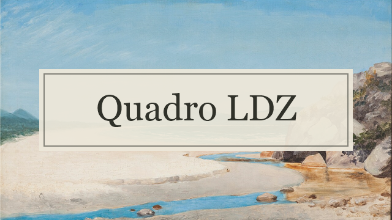
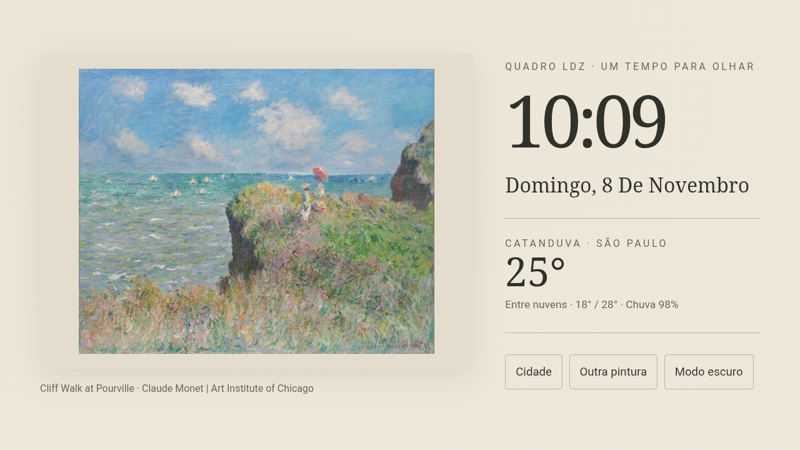
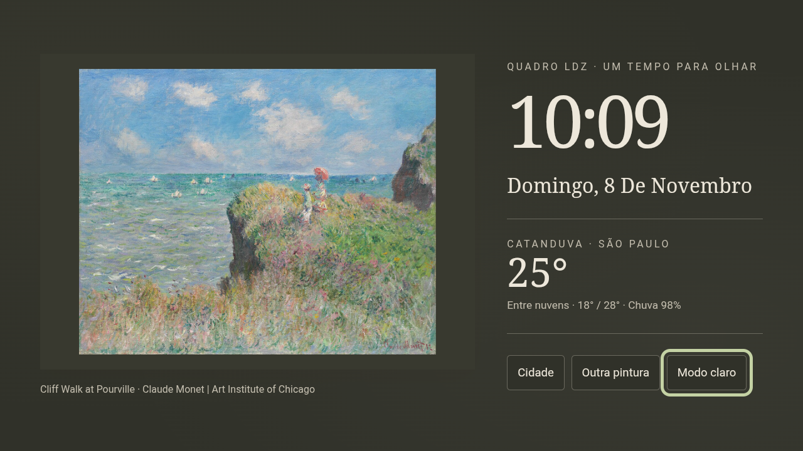

# Quadro LDZ



Um quadro digital com **arte, hora e clima** para Android TV e tablets na horizontal. Visual inspirado em papel, leitura à distância e 40 pinturas incluídas no aplicativo, sem depender de uma central de automação.

[Baixar APK](https://github.com/ludezam/Quadro-LDZ/releases/latest) · [Instalação](#instalação) · [Compilar](docs/BUILD.md) · [Créditos](THIRD_PARTY_NOTICES.md) · [Privacidade](PRIVACY.md)

## Recursos

- **40 pinturas offline**, com 30 obras do Art Institute of Chicago e dez brasileiras de Almeida Júnior, Benedito Calixto, Antônio Parreiras, Eliseu Visconti e Abigail de Andrade.
- Uma nova obra a cada **15 minutos**, além do botão de troca manual.
- Hora e data no fuso da cidade escolhida.
- Temperatura atual, condição do tempo, mínima, máxima e probabilidade de chuva.
- Busca da cidade na primeira abertura e alteração pelo menu.
- Temas claro e escuro, preservando as cores originais das obras.
- Preferências salvas no próprio aparelho; sem conta, anúncios ou analytics próprios.
- Interface horizontal com navegação por controle remoto e suporte a toque.

Não é necessário Home Assistant. Esta versão não inclui reprodução de música ou YouTube.

## Aparência

| Claro | Escuro |
| --- | --- |
|  |  |

Capturas da interface em TCL Android 11. O layout se mantém na versão 0.3.0, que acrescenta o novo ícone e as pinturas brasileiras.

## Instalação

1. Acesse [Releases](https://github.com/ludezam/Quadro-LDZ/releases) e baixe o APK da versão desejada.
2. Transfira para a TV ou tablet e abra com um instalador de APK confiável. Autorize a instalação para esse instalador quando o Android solicitar.
3. Abra **Quadro LDZ** no menu de aplicativos.
4. Pesquise sua cidade e escolha o resultado correto.

Requisitos: **Android 9 ou superior**, aparelho em orientação horizontal e WebView funcional. A busca de cidades e o clima exigem internet; pinturas e relógio continuam disponíveis offline.

Com ADB já configurado e o aparelho autorizado:

```text
adb install -r Quadro-LDZ-0.3.0-teste.apk
adb shell am start -n br.com.galeria.painel/.MainActivity
```

O APK publicado usa assinatura de desenvolvimento, para distribuição direta e avaliação. A chave privada não é distribuída. Instalações compiladas por terceiros ou por CI podem usar outra assinatura e não atualizar a instalação existente. Não há atualização automática ou publicação na Play Store.

## Uso

| Controle | Ação |
| --- | --- |
| Cidade | Pesquisar e alterar a cidade; consultar créditos do clima |
| Outra pintura | Avançar na coleção offline |
| Modo escuro / Modo claro | Trocar e salvar o tema |
| Setas e OK | Navegar e selecionar na TV |
| Voltar | Fechar o diálogo ou exibir orientação de saída |
| Início do controle | Sair para o launcher da TV |

As obras brasileiras aparecem intercaladas com as demais. Ao retornar ao app depois do prazo de rotação, ele troca a pintura; na próxima abertura, continua a sequência salva. O clima é consultado na abertura, no retorno ao app, na reconexão e a cada 30 minutos enquanto ativo. Falhas de atualização são identificadas na tela.

## Compatibilidade e estado da versão

**Versão pública inicial: 0.3.0.** Instalação, telas e ícone foram validados em TCL Android 11. A versão mínima declarada é Android 9, mas a TCL 43S6500 com Android 9, tablets, Androids superiores e outros fabricantes ainda não foram testados em aparelho. Não há versão máxima declarada.

O app mantém a tela acordada enquanto aberto. Não controla brilho físico, energia, carga ou inicialização automática da TV. Não há favoritos, seleção de coleção ou intervalo configurável nesta versão.

Consulte [Validação e limitações](docs/TESTING.md) e o [Histórico de versões](CHANGELOG.md).

## Compilação e contribuição

O processo validado usa **JDK 17, Android SDK 34, Build-Tools 34.0.0 e PowerShell**:

```powershell
node tools/verify-panel.cjs
./build-apk.ps1
```

Configure `JAVA_HOME` e `ANDROID_HOME`, ou ajuste uma cópia local de `tools.local.example.json`. As pinturas já estão no repositório: nenhum download de acervo é necessário para compilar.

[Instruções completas](docs/BUILD.md) · [Como contribuir](CONTRIBUTING.md) · [Relatar problema](https://github.com/ludezam/Quadro-LDZ/issues)

## Créditos e licença

Código sob [licença MIT](LICENSE). As pinturas e os dados de terceiros têm condições próprias, detalhadas em [Créditos e licenças](THIRD_PARTY_NOTICES.md). Cada imagem possui título, artista, origem e licença no [catálogo](app/src/main/assets/art/catalog.json).

Clima: [Open-Meteo](https://open-meteo.com/), CC BY 4.0. Cidades: GeoNames via Open-Meteo. **A API gratuita usada pelo app destina-se ao uso não comercial**; para exploração comercial, é necessário adequar o serviço aos termos do provedor. A licença do código não substitui esses termos.

Projeto independente, sem vínculo ou endosso dos museus e serviços citados.
